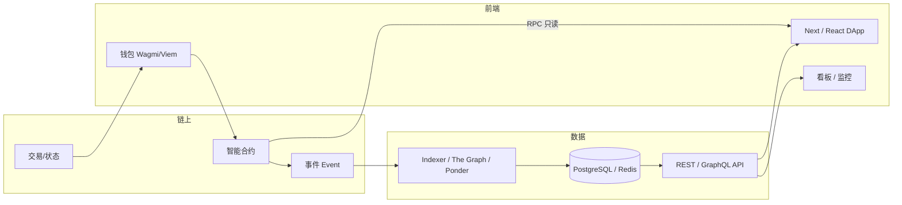

# Web3 知识点思维导图

> 覆盖登链社区《Web3 学习路线图》主要节点，并标注本路线项目落点（Pxx）与掌握度。
> 图例：★★★ 掌握 · ★★ 推荐了解 · ★ 兴趣拓展

---

## 总览图（Mermaid）

```mermaid
mindmap
  root((Web3 学习))
    预备知识 S0
      计算机基础
      数据库
      数据结构
      计算机网络
      编程语言
    区块链基础 S1
      what 什么是区块链
      How 如何工作
        非对称加密
        Hash 算法
        P2P 网络
        椭圆曲线
        分布式账本
      Why 为什么需要
      链上交互
        钱包
        加密货币
        区块链浏览器
        共识机制
    开发方向
      应用开发 S2-S5
        智能合约
        DApp 全栈
        生态专项
        高级 DeFi/安全
      链开发 S6
        开发新链
        二层扩容
        模块化
        ZKP
    生态选择 S4
      比特币 BTC
      EVM 生态
      Solana
      Sui / Aptos
      其他
    智能合约 S2-S3
      开发语言
      开发框架库
      Token 标准
      IDE
      测试
    合约进阶 S3-S5
      Gas 与低级
      架构模式
      DeFi/DAO
      安全审计
    DApp 开发 S3
      钱包集成
      合约交互
      前端框架
      数据索引
      节点服务
      应用托管
```



---

## 1. 预备知识（S0）

| 节点 | 掌握度 | 要点 | 项目落点 |
|------|--------|------|----------|
| 计算机基础 | ★★★ | 进程/内存/编码/字节 | 贯穿 |
| 数据库 | ★★★ | SQL、索引、事务 | P00 表设计 / P09 |
| 数据结构 | ★★★ | 哈希链、Merkle、映射 | P01/P02 |
| 计算机网络 | ★★★ | HTTP、WS、P2P 概念 | P02/P03 |
| 编程语言 | ★★★ | Solidity + TS 主线；Rust/Go/Move 扩展 | 各合约项目 |

---

## 2. 区块链基础（S1 · P01–P03）

### 2.1 What / How / Why

```text
区块链基础
├── what 什么是区块链
│     ├── 区块 / 交易 / 状态
│     └── 分布式账本 ★★★
├── How 如何工作的？
│     ├── 非对称加密 ★★★
│     ├── Hash 算法 ★★★
│     ├── P2P 网络 ★★★
│     └── 椭圆曲线 ★★★
└── Why 为什么需要？
      ├── 信任机器 / 抗审查
      └── 与中心化对照
```

### 2.2 链上交互（区块链初探）

| 节点 | 掌握度 | 项目落点 |
|------|--------|----------|
| 钱包 | ★★★ | P03 MetaMask |
| 加密货币 | ★★★ | P03 转账/水龙头 |
| 区块链浏览器 | ★★★ | P03 Etherscan 解析 |
| 了解共识机制 | ★★★ | P02 PoW/PoS 概念 |

---

## 3. 开发方向

```text
开发方向
├── 链开发（S6 专家）
│     ├── 开发新链
│     │     ├── Geth ★★ / Reth ★★
│     │     ├── Substrate ★★
│     │     └── Cosmos SDK ★★
│     ├── 组网与运维（P26）★★
│     │     ├── EL + CL + VC 三进程与 JWT
│     │     ├── bootnode / ENR / nat_exit_ip
│     │     ├── 最终性（safe / finalized）
│     │     └── 密钥治理与防火墙（30303 / 9000）
│     ├── 二层扩容
│     │     ├── OP Stack ★★
│     │     ├── Polygon CDK ★★
│     │     ├── StarkEx ★
│     │     ├── Arbitrum Stylus ★
│     │     └── Arbitrum Orbit ★
│     ├── 模块化
│     │     ├── 执行层 ★
│     │     ├── 结算层 ★
│     │     ├── 共识层 ★
│     │     └── 数据可用性 ★
│     └── ZKP ★
└── 应用开发（S2–S5 主线）
      └── 本路线默认主线
```

---

## 4. 选择生态（S4）

| 生态 | 颜色（原图） | 核心节点 | 项目 |
|------|--------------|----------|------|
| **比特币 BTC** | 黄 | 脚本编程、UTXO、操作码、资产协议 | P13–P14 |
| **EVM 生态** | 紫 | 以太坊、BNB、Avalanche、Polygon、Gnosis、Tron | P04–P12 |
| **Solana** | 绿 | Rust/Anchor、PDA、CPI、Token 扩展 | P15 |
| **Sui / Aptos** | 蓝 | Move、资源模型、Capability、泛型 | P16 |
| **其他** ★ | — | TON、Arweave/AO、Near、ICP | 探索笔记 |

### 4.1 比特币 BTC

```text
比特币(BTC)
├── 脚本编程 ★★★
│     ├── UTXO 模型
│     └── 操作码
├── 资产协议 ★★
│     ├── RGB ★
│     ├── Ordinals ★★
│     ├── Runes ★★
│     └── Atomicals ★
├── 链外合约 ★
├── 索引器 ★★
└── 客户端验证 ★
```

### 4.2 EVM 与 Layer2s

```text
EVM 生态
├── L1：以太坊、BNB Chain、Avalanche C、Polygon、Gnosis、Tron
└── Layer2s
      ├── EVM 兼容：Arbitrum、Optimism、ZKsync、Scroll、Base
      └── 其他：Starknet、Fuel、Movement
```

### 4.3 Solana / Move 要点

| Solana | Sui / Aptos |
|--------|-------------|
| Rust ★★★ | Move ★★★ |
| Anchor ★★★ | Sui / Aptos Framework ★★★ |
| SPL-Token / PDA ★★★ | 资源模型 ★★★ |
| CPI ★★ | Capability ★★ |
| 账户模型 ★★★ | 集合 / 泛型 ★★ |
| Token 扩展 ★★ | Move Studio / Pontem Studio ★ |
| SolPg ★★ | Sui Wallet Kit / SDK / dApp Kit |
| Phantom / wallet-adapter | Sui Indexer ★ |

---

## 5. 智能合约（S2–S3 · P04–P08）

```text
智能合约
├── 开发语言 ★★★
│     ├── Solidity ★★★
│     ├── Vyper ★★
│     ├── Fe ★
│     ├── Yul ★★
│     └── Cairo ★
├── 开发框架/库 ★★★
│     ├── Foundry ★★★
│     ├── Hardhat ★★
│     ├── Brownie ★
│     ├── Ape ★
│     └── OpenZeppelin ★★★
├── Token 标准 ★★★
│     ├── ERC20 / ERC2612
│     ├── ERC777 ★
│     ├── ERC721
│     └── ERC1155
├── IDE ★★
│     ├── VS Code ★★★
│     ├── IntelliJ ★★
│     └── Remix ★★★
└── 测试 ★★★
      ├── 单元 / fuzz / invariant
      └── fork 测试
```

---

## 6. 合约进阶（S3–S5 · P08/P10/P17–P21）

```text
合约进阶
├── 性能与低级
│     ├── Gas 优化 ★★★
│     ├── Create2 ★★★
│     ├── Call / Delegate ★★★
│     └── 账户抽象 ★★★
├── 架构
│     ├── 合约升级（UUPS/Transparent）★★★
│     ├── Merkle 树 ★★★
│     └── 离线签名 ★★★
├── 业务原语
│     ├── DEFI ★★★
│     ├── 闪电贷 ★★
│     ├── DAO ★★★
│     ├── 预言机 ★★★
│     └── 跨链 ★★
└── 安全
      ├── 常见安全问题 ★★★
      ├── 合约审计 ★★★
      ├── 静态分析工具 ★★★
      └── ZKP 接口 ★
```

**八大必会漏洞（P20）**：重入 · 权限 · 精度 · 签名重放 · 预言机操纵 · 闪电贷治理 · 初始化暴露 · delegatecall 碰撞。

---

## 7. DApp 开发（S3 · P06/P07/P09）

```text
DAPP 开发
├── 钱包集成 ★★★
│     ├── MetaMask ★★★
│     ├── WalletConnect ★★
│     ├── Web3 Model ★★
│     └── RainbowKit ★★
├── 合约交互 ★★★
│     ├── ABI ★★★
│     ├── Ethers.js ★★
│     ├── Web3.js ★★
│     ├── Viem.sh ★★★
│     ├── 合约监控/自动化 ★★
│     │     ├── Chainlink Automation ★★
│     │     └── OpenZeppelin Monitor ★★
│     └── Wagmi ★★★
├── 前端框架 ★★★
│     ├── React ★★★
│     ├── Next.js ★★★
│     ├── TailwindCSS ★★
│     ├── Angular / Vue ★
├── 数据索引 ★★★
│     ├── The Graph ★★★
│     ├── Dune ★★
│     └── 三方数据服务 ★★
├── 节点服务 ★★★
│     ├── Infura / Alchemy / QuickNode
│     └── 自建 RPC ★★
└── 应用托管 ★★
      ├── Vercel ★★
      ├── IPFS ★★
      └── GitHub ★★★
```

---

## 8. 数据对接链路（后端 → 数据 → 前端）



| 层 | 技术 | 落点 |
|----|------|------|
| 合约后端 | Solidity/Foundry、Rust/Anchor、Move | P04–P08, P15–P16 |
| 链下后端 | Spring Boot / Node Indexer、API | P09 |
| 数据 | The Graph、Dune、自建 DB | P09 |
| 前端 | React/Next + Tailwind + Wagmi/Viem | P06–P07 |
| 节点/托管 | Infura/Alchemy、Vercel、IPFS | P03/P09 |

---

## 9. 高级应用与专家扩展

```text
高级应用 S5
├── Mini AMM / DEX
├── 借贷 / 质押 / 清算
├── DAO 治理与金库
├── 安全审计实战
└── 监控与应急

专家 / 超纲 S6
├── 链客户端：Geth、Reth（Go/Rust）
├── 应用链：Substrate、Cosmos SDK
├── L2 Stack：OP Stack、Polygon CDK、StarkEx、Arbitrum Orbit/Stylus
├── 模块化：执行 / 结算 / 共识 / DA
├── ZKP：Circom、Halo2、Noir、zkEVM
└── 融合题：Web3×AI、DePIN、RWA、链游、意图(Intent)、账户抽象钱包
```

---

## 10. 掌握度速查（对齐原图勾选）

| 标记 | 知识域 |
|------|--------|
| ★★★ 熟悉理解掌握 | 预备五项、区块链基础五件套、钱包/浏览器、Solidity+Foundry、ERC20/721/1155、Gas/升级/安全、Wagmi+Viem、The Graph、测试 |
| ★★ 推荐了解 | Vyper/Yul、Hardhat、L2 主流、BTC 资产协议、Solana/Anchor、预言机、跨链、审计工具、Infura/Alchemy |
| ★ 兴趣拓展 | Fe/Cairo/Brownie、Substrate/Cosmos、StarkEx/Orbit、模块化 DA、ZKP、TON/Near/ICP、闪电贷高级玩法 |

---

## 11. 项目 × 知识点索引表

| 项目 | 主要知识域 |
|------|------------|
| P01 | 区块链基础 what/How/Why、Merkle、加密 |
| P02 | 区块结构、共识、P2P、钱包签名 |
| P03 | 钱包、浏览器、Gas、交易生命周期 |
| P04 | Solidity、Foundry、测试、部署 |
| P05 | ERC20、权限、Permit |
| P06 | ABI、Wagmi、React、事件 |
| P07 | ERC721/1155、IPFS、市场 |
| P08 | Gas、Create2、Delegate、升级、AA |
| P09 | Indexer、Graph、API、看板 |
| P10 | 预言机、Automation、监控 |
| P11–P12 | 多链、L2、跨链 |
| P13–P14 | BTC UTXO/脚本/资产协议 |
| P15 | Solana/Rust/Anchor/PDA/CPI |
| P16 | Move/资源模型/Sui SDK |
| P17–P18 | DeFi AMM、借贷、清算 |
| P19 | DAO、多签、时间锁、Merkle 空投 |
| P20–P21 | 安全、审计、监控应急 |
| P22–P25 | 链开发、L2、ZK |
| **P26** | 私有 PoS 组网：EL/CL/VC、bootnode、JWT、最终性、NAT 与防火墙、密钥治理 |
| G* | 综合毕业 |

---

## 12. 周复盘勾选模板

```markdown
## 本周复盘
- 项目：
- 完成节点（打勾思维导图编号）：
- 最有价值的一个「原来如此」：
- 对照 Java/传统开发的差异：
- 卡点与下周要补：
```
